<p align="center">
  <picture>
    <source media="(prefers-color-scheme: dark)" srcset="docs/logo-dark.png">
    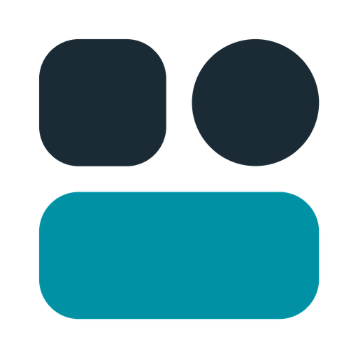
  </picture>
</p>

<h1 align="center">Dashboard</h1>

<p align="center">
  My start page: today's tasks and habits, calendar, money, chess and Estonian basketball on one screen, plus live NBA, EuroLeague and Estonian-Latvian league views.
</p>

<p align="center">
  <a href="https://erko-dashboard-demo.vercel.app"></a>
</p>

<p align="center">
  
  
  
  
  
  
  
</p>

<br>

<p align="center">
  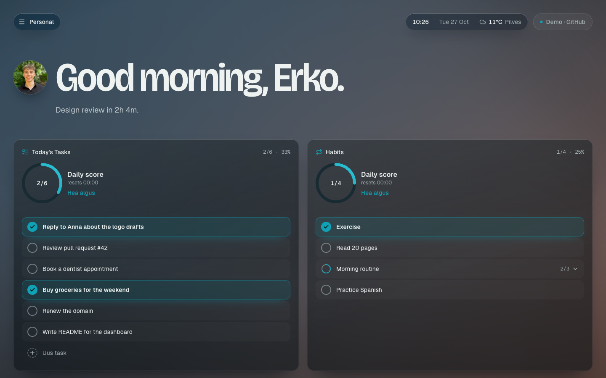
</p>

> [!NOTE]
> The demo needs no login. Tasks, habits, projects, calendar, money, notes and files are made-up sample data that lives in your browser: change anything you like, a reload brings the demo back. The NBA, EuroLeague and Est-Lat views, Delfi news and the weather are live.

## What's inside

The dashboard is one page with a side menu. Each menu item is a view.

### Personal

<table>
  <tr>
    <td width="50%" valign="top">
      <b>Today's Tasks</b><br>
      One checklist for the day, built from three sources: day tasks, project tasks due today and calendar events marked as tasks. Ticking a project task completes it in the project too. A ring shows the daily score.
    </td>
    <td width="50%" valign="top">
      <b>Habits</b><br>
      Daily habits as checklist rows. A habit can have sub-habits that open under it, and the parent counts as done once all of its children are.
    </td>
  </tr>
  <tr>
    <td width="50%" valign="top">
      <b>Calendar</b><br>
      Today's and this week's Google Calendar events. Add one-off or weekly events, or mark an event as a task so it shows up in Today's Tasks. The header counts down to the next event.
    </td>
    <td width="50%" valign="top">
      <b>Chess</b><br>
      Chess.com rapid rating with a three-month trend line, plus wins, losses and draws for this week and all time.
    </td>
  </tr>
  <tr>
    <td width="50%" valign="top">
      <b>Finance</b><br>
      Bank balance and this month's income, expenses and net from FinanceTracker. An optional PIN, checked on the server, hides the numbers.
    </td>
    <td width="50%" valign="top">
      <b>EstHoop</b><br>
      The Estonian national team's next game with a live countdown, the latest result and its top scorer, and the club games of national team players.
    </td>
  </tr>
</table>

The header has a clock, the weather in Tallinn and an animated WebGL sky that changes with the time of day.

<p align="center">
  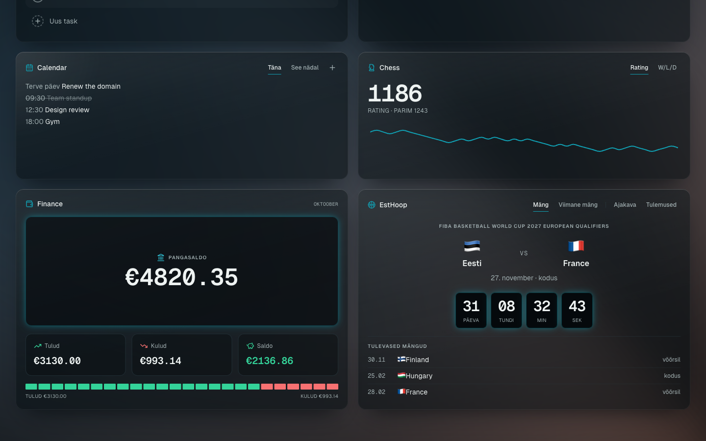
</p>

### Other views

- **Taskmanager**: every open task in one list, from today's tasks and all projects. Filter by source, project or date, drag to reorder, set due dates and criticality, move tasks between projects.
- **Quick Notes**: a single rich-text scratchpad (Tiptap) that saves as you type.
- **File system**: folders and rich-text files in a tree. Drag to move and reorder.
- **Delfi korvpall**: the latest basketball news from [sport.delfi.ee](https://sport.delfi.ee).

<table>
  <tr>
    <td width="50%">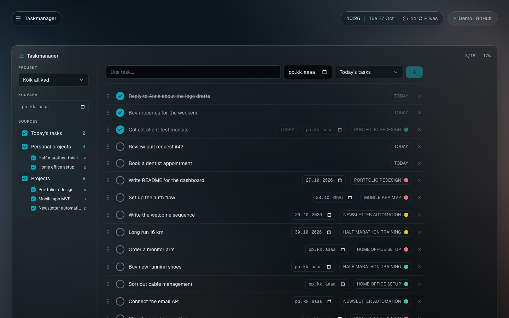</td>
    <td width="50%">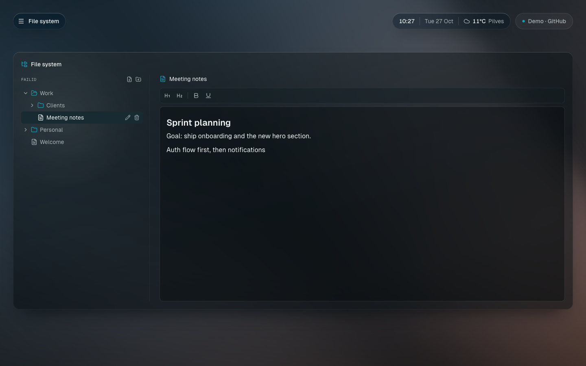</td>
  </tr>
</table>

### NBA, EuroLeague and Est-Lat Liiga

All three leagues share the same views:

- **Games** for today, 3 days, 7 days, a month or the whole season. Open a finished game for the full boxscore. NBA and EuroLeague games get their YouTube recap, which plays right in the list.
- **Best performances**: each player's best game in the chosen period, by efficiency (EFF in the NBA, PIR in the EuroLeague, EF in Est-Lat), points, rebounds or assists.
- **MVP race**: season leaders by efficiency per game with their full stat line.
- **Standings** with home and away records, last 10 games and streaks.

<table>
  <tr>
    <td width="50%">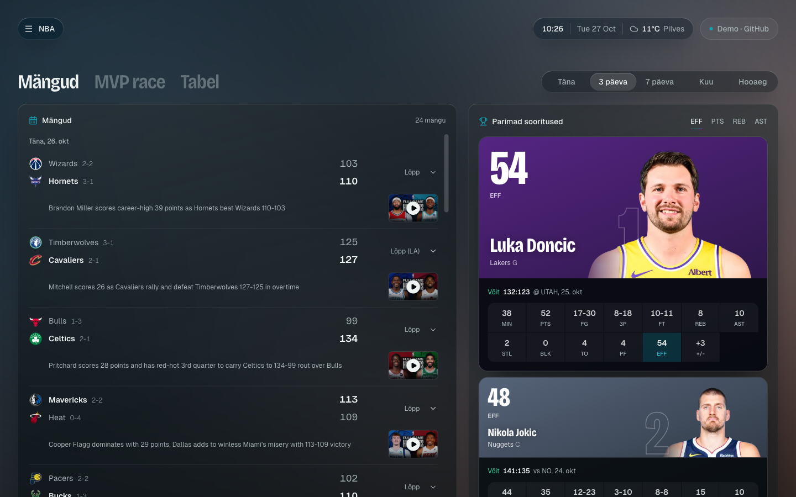</td>
    <td width="50%">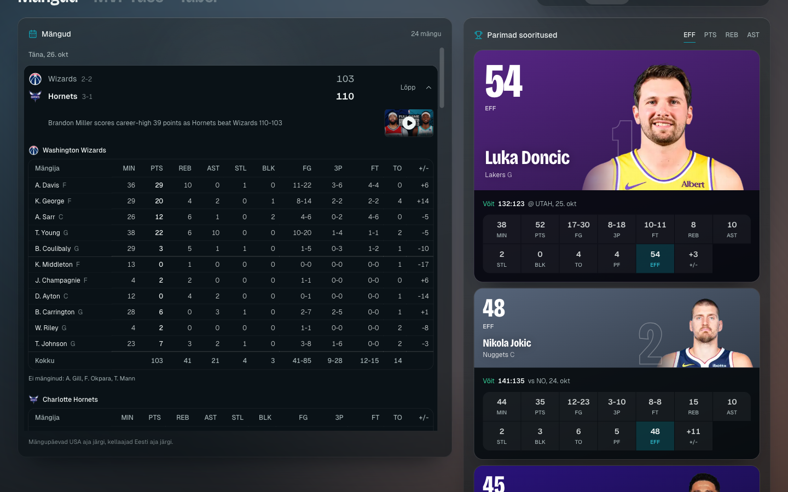</td>
  </tr>
  <tr>
    <td width="50%">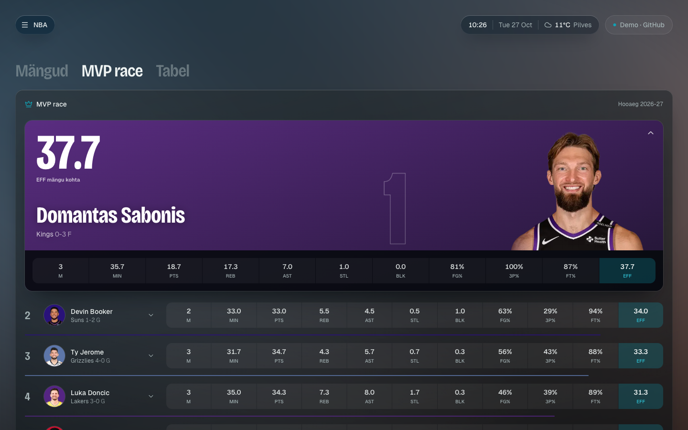</td>
    <td width="50%">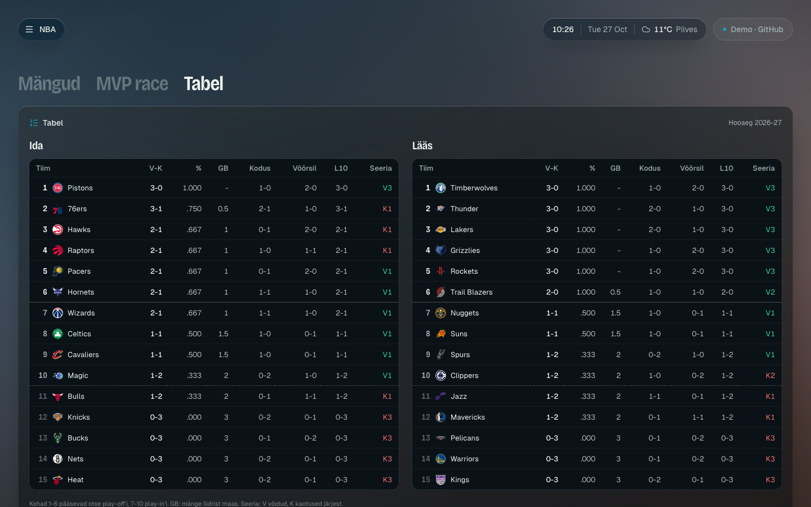</td>
  </tr>
  <tr>
    <td width="50%">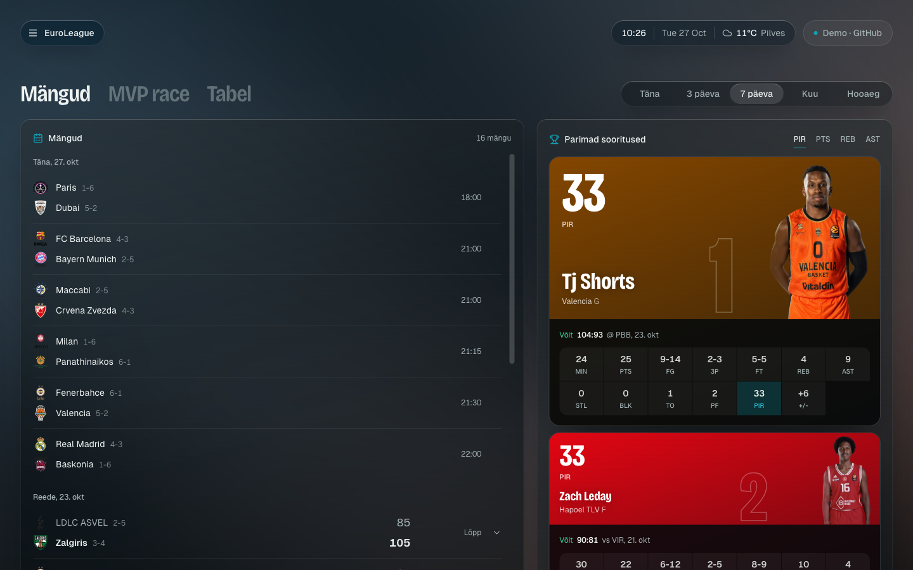</td>
    <td width="50%">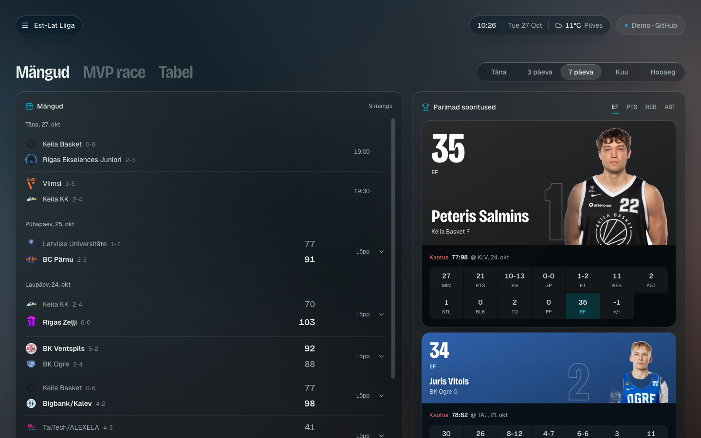</td>
  </tr>
</table>

It works on a phone too, and installs as an app (PWA).

<p align="center">
  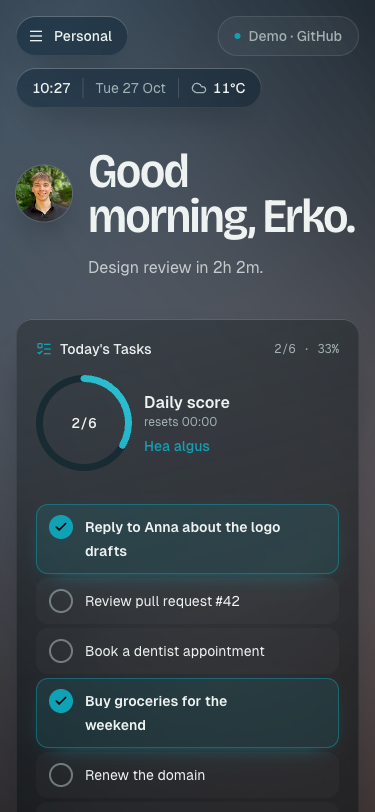
  &nbsp;
  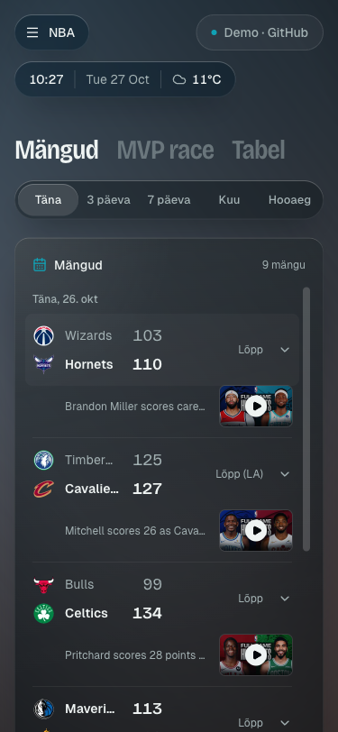
  &nbsp;
  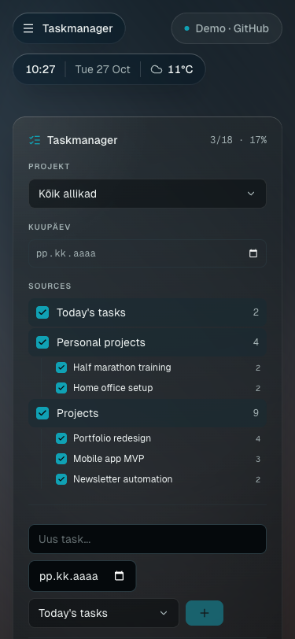
</p>

### iPhone widget

A large home screen widget shows today's tasks and habits with progress, the next calendar events and the weather. Tapping it opens the dashboard. iOS has no widgets for web apps, so the widget is a [Scriptable](https://scriptable.app) script that reads a read-only endpoint, `/api/widget`, protected by its own token.

1. Create a token and set it as `DASHBOARD_WIDGET_TOKEN` in `.env.local` and in Vercel. Vercel also needs `TASKS_SUPABASE_SERVICE_ROLE_KEY`.

   ```bash
   openssl rand -hex 32 | pbcopy
   ```

2. Install Scriptable on the iPhone, create a new script and paste in [`scripts/scriptable/dashboard-widget.js`](scripts/scriptable/dashboard-widget.js).
3. Run the script once in the app and enter the dashboard address and the token. Both stay in the phone's Keychain, not in the script.
4. Add a large Scriptable widget to the home screen and pick the script. iOS refreshes it about every 15 to 30 minutes.

## How it works

There is no separate backend. The browser reads and writes two Supabase projects directly, under Row Level Security. Everything that needs a secret key, or a site without CORS, goes through Next.js route handlers under `app/api`, which run on Vercel in Frankfurt (`fra1`).

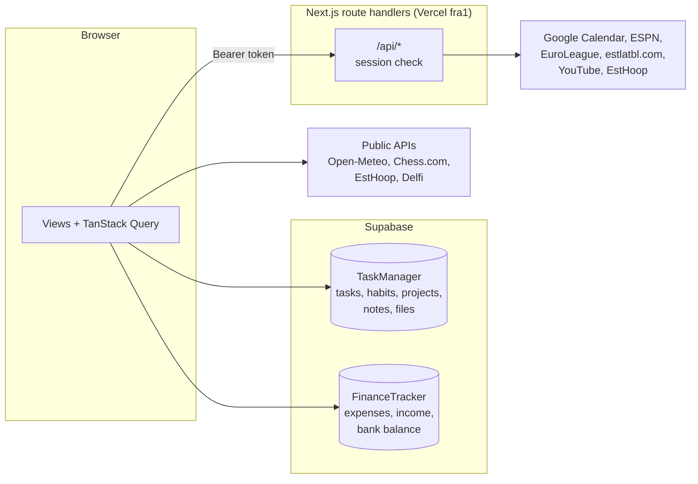

- **Two Supabase projects, two sessions.** Tasks and money live in the databases of my other apps, [TaskZen](https://github.com/ErkoKaar/TaskZen) and [FinanceTracker](https://github.com/ErkoKaar/FinanceTracker), which have separate auth. The login form takes an email and two passwords and signs in to both (`providers/AuthProvider.tsx`). The dashboard opens only when both sessions exist.
- **Secrets stay on the server.** Every `/api` route checks the TaskManager session token first (`lib/server/requireUser.ts`). A verified token is remembered for up to five minutes, so a page load does not ask Supabase a dozen times.
- **Strict Content Security Policy.** `middleware.ts` sets a CSP with a new nonce on every request, and `connect-src` lists only the services the browser really talks to.
- **Sports data.** The NBA comes from ESPN's public API, the EuroLeague from its official API, and the Est-Lat league is read from the HTML tables on estlatbl.com, since it has no API. All three are mapped to the same types, so one set of components serves every league. Recaps are matched to games through the YouTube Data API, or the channel's RSS feed when no key is set. Server responses are cached, and the league views are also kept in `localStorage` for 24 hours, so they open instantly and refresh in the background.
- **Images.** Player photos go through the Next.js image optimizer (an ESPN PNG drops from about 220 KB to 30 KB as WebP). Est-Lat photos get their white background removed on a canvas.
- **Demo mode.** With `NEXT_PUBLIC_DEMO_MODE=1` both Supabase clients are swapped for a small in-memory PostgREST stand-in ([`lib/demo`](lib/demo)) seeded with sample data relative to today, and the login is skipped. Calendar and Finance PIN calls are answered in the browser. On the server only the public sports routes stay open, and calendar, PIN and every other keyed route return 404 even if keys were set. The [live demo](https://erko-dashboard-demo.vercel.app) is a second Vercel project built from this repo with that variable.

## Tech stack

| Layer | Tools |
|---|---|
| Framework | Next.js 15 (App Router), React 19, TypeScript |
| Data | TanStack Query 5 with a `localStorage` persister, Supabase JS |
| UI | Tailwind CSS 3, lucide-react, Recharts, dnd-kit, Tiptap, anime.js, ShaderGradient (three.js) for the sky |
| Data sources | Supabase (x2), Google Calendar API, ESPN, EuroLeague API, estlatbl.com, YouTube, EstHoop API, Delfi, Chess.com, Open-Meteo |
| Hosting | Vercel, functions in `fra1` |

## Getting started

1. Install dependencies and create your env file:

   ```bash
   npm install
   cp .env.local.example .env.local
   ```

2. Fill in `.env.local`. `.env.local.example` explains each value, including the one-time OAuth setup for Google Calendar.

   | Variable | Used for |
   |---|---|
   | `NEXT_PUBLIC_TASKS_SUPABASE_URL`, `_ANON_KEY` | TaskManager Supabase project (tasks, habits, projects, notes, files) |
   | `NEXT_PUBLIC_FINANCE_SUPABASE_URL`, `_ANON_KEY` | FinanceTracker Supabase project |
   | `NEXT_PUBLIC_ESTHOOP_API_URL` | EstHoop backend; its CORS list must include this dashboard's origin |
   | `NEXT_PUBLIC_CHESS_USERNAME` | Chess.com username |
   | `DASHBOARD_ALLOWED_USER_ID` | Server only, required: the one TaskManager user the API serves; without it every API request is refused |
   | `GOOGLE_CLIENT_ID`, `GOOGLE_CLIENT_SECRET`, `GOOGLE_REFRESH_TOKEN` | Server only: Google Calendar |
   | `YOUTUBE_API_KEY` | Server only, optional: recaps for the last 30 days instead of the RSS feed's last few |
   | `FINANCE_WIDGET_PIN` | Server only, optional: PIN lock for the Finance widget |
   | `DASHBOARD_WIDGET_TOKEN`, `TASKS_SUPABASE_SERVICE_ROLE_KEY` | Server only, optional: the [iPhone widget](#iphone-widget) endpoint |
   | `NEXT_PUBLIC_DEMO_MODE` | `1` runs the demo with sample data and no keys |

3. The tables come from the TaskZen and FinanceTracker projects. The dashboard's own additions are in [`supabase/`](supabase): run them in the TaskManager project's SQL Editor.

4. Start the dev server and open [localhost:3100](http://localhost:3100):

   ```bash
   npm run dev
   ```

To look around without any accounts or keys, start it in demo mode:

```bash
NEXT_PUBLIC_DEMO_MODE=1 npm run dev
```

| Command | What it does |
|---|---|
| `npm run dev` | Dev server on port 3100 |
| `npm run build` | Production build |
| `npm run start` | Serve the production build |
| `npm run lint` | ESLint |
| `npm run format` | Prettier with Tailwind class sorting |
| `npx tsc --noEmit` | Type check |

## Project structure

```
app/
  page.tsx                 The single page: login gate, side menu, header, views
  layout.tsx, manifest.ts  Fonts, providers, sky backdrop, PWA manifest
  api/
    calendar/              Google Calendar (OAuth refresh token)
    nba/, euroleague/, estlat/
                           games, boxscore, leaders, mvp, standings per league
    esthoop-club-*/        Club games of national team players
    finance-pin/           PIN check for the Finance widget
    widget/                Read-only data for the iPhone widget (own token)
components/
  widgets/                 One component per widget or view
  widgets/nba/             League views shared by NBA, EuroLeague and Est-Lat
  ui/                      Card, checklist row, side menu, sky, rich-text editor and other primitives
lib/
  queries/                 TanStack Query hooks, one file per data source
  nba/, euroleague/, estlat/
                           Server-side league adapters to one shared shape
  basketball/              Shared league code: leaders, periods, YouTube recaps
  supabase/                The two Supabase clients
  server/requireUser.ts    Session and allowed-user check for /api routes
  today.ts                 Today's tasks and habits, shared by the widgets and /api/widget
  demo/                    Demo mode: sample data and in-memory Supabase
  widgets.ts               Which widget belongs to which view
providers/                 AuthProvider (two sessions), QueryProvider (cache persistence)
middleware.ts              Content Security Policy with a per-request nonce
supabase/                  SQL for the dashboard's own columns and tables
scripts/scriptable/        iPhone home screen widget (Scriptable)
docs/screenshots/          README images, taken from the demo
```

## Deployment

Both sites deploy from `main` on Vercel. The dashboard itself needs the variables above in its project settings. The demo is a separate project with `NEXT_PUBLIC_DEMO_MODE=1` and the public `NEXT_PUBLIC_ESTHOOP_API_URL`, and no other keys.
